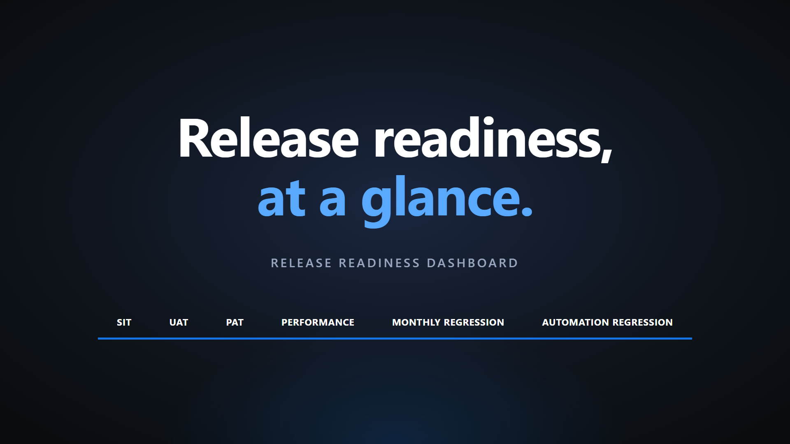

# Release Readiness & Testing Hub

A single page that turns Jira test and defect data into a go / no-go view for every test cycle, built for a large, multi-vendor global transformation program. (Shown in the demo as the "Release Readiness Dashboard.")

## What it shows

- **Exit criteria by workstream:** entry and exit checkpoints computed from Jira.
- **Execution against target:** executed vs. planned, by workstream, per cycle.
- **Defect insight:** creation and accumulation trends, plus breakdowns by severity, type and workstream.
- **Drill-down:** every number opens the tickets behind it.
- **Freshness:** refreshed from Jira every 5 minutes.

## How it works

Jira (read-only query) → fetch & cache (every 5 minutes) → reshape issues → cycle settings → page & charts → single sign-on → leaders in a browser.

## In this folder

| File | What it is |
|:--|:--|
| [`demo.mp4`](demo.mp4) | 50-second product tour |
| [`tour.jpg`](tour.jpg) | Poster frame |
| [`tour-plan.md`](tour-plan.md) | Storyboard and production plan |
